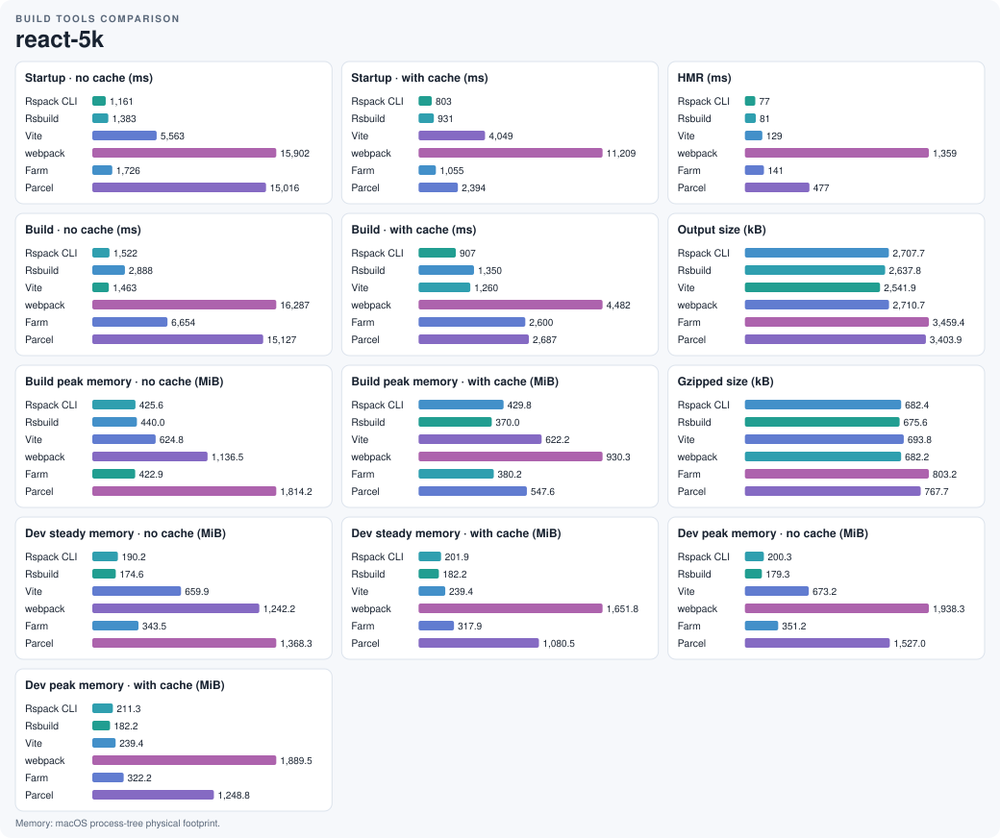
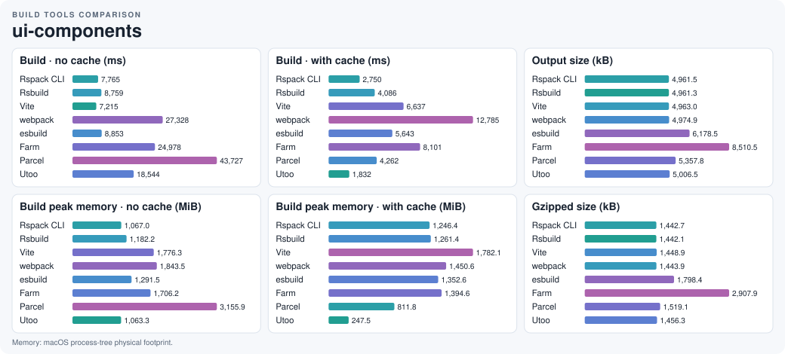

# Build Tools Comparison

Benchmark comparing JavaScript bundlers and build tools ([Rspack](https://github.com/web-infra-dev/rspack), [Rsbuild](https://github.com/web-infra-dev/rsbuild), [webpack](https://github.com/webpack/webpack), [Vite](https://github.com/vitejs/vite), [Rolldown](https://github.com/rolldown/rolldown), [esbuild](https://github.com/evanw/esbuild), [Rollup](https://github.com/rollup/rollup), [Parcel](https://github.com/parcel-bundler/parcel), [Farm](https://github.com/farm-fe/farm), [Utoo](https://github.com/utooland/utoo) and [Bun](https://bun.com)) for dev server startup time, build performance and bundle size for applications with different module sizes.

## Results

See [metrics](#metrics) and [notes](#notes) for details.

> Data from [GitHub Actions](https://github.com/rstackjs/build-tools-performance/actions/runs/44268018576) (2026-11-18 UTC+8, benchmark commit `f43edc1a`). Memory uses macOS process-tree physical footprint.

---

### react-dashboard

A synthetic enterprise operations dashboard with 60 lazy routes across 8 business domains, CSS Modules, and 37 common libraries, including React, TanStack Router, Zod, and Recharts.

See [case details](cases/react-dashboard/README.md).

```bash
CASE=react-dashboard pnpm benchmark
```

<!-- benchmark-chart:start -->
<picture>
  <source media="(prefers-color-scheme: dark)" srcset="assets/charts/react-dashboard-dark.svg">
  
</picture>
<!-- benchmark-chart:end -->

<details>
<summary>Full benchmark data</summary>

Development metrics:

| Name             | Startup (no cache) | Startup (with cache) | HMR    |
| ---------------- | ------------------ | -------------------- | ------ |
| Rspack CLI 2.3.2 | 1202ms🥇           | 1009ms🥈             | 67ms🥈 |
| Rsbuild 2.3.2    | 1376ms🥈           | 920ms🥇              | 67ms🥉 |
| Vite 8.3.8       | 4660ms             | 1531ms               | 69ms   |
| webpack 5.112.2  | 4488ms             | 2821ms               | 357ms  |
| Utoo 1.6.4       | 2997ms🥉           | 1067ms🥉             | 66ms🥇 |

Build metrics:

| Name             | Build (no cache) | Build (with cache) | Output size | Gzipped size |
| ---------------- | ---------------- | ------------------ | ----------- | ------------ |
| Rspack CLI 2.3.2 | 6321ms🥉         | 1973ms🥉           | 8535.7kB🥈  | 1074.3kB     |
| Rsbuild 2.3.2    | 4535ms🥈         | 1571ms🥇           | 8787.0kB    | 1093.2kB     |
| Vite 8.3.8       | 2367ms🥇         | 2426ms             | 8648.2kB    | 1040.8kB🥈   |
| webpack 5.112.2  | 29259ms          | 8763ms             | 8508.1kB🥇  | 1070.5kB🥉   |
| Utoo 1.6.4       | 17453ms          | 1819ms🥈           | 8582.0kB🥉  | 929.0kB🥇    |

Dev memory (MiB):

| Name             | Steady (no cache) | Steady (with cache) | Peak (no cache) | Peak (with cache) |
| ---------------- | ----------------- | ------------------- | --------------- | ----------------- |
| Rspack CLI 2.3.2 | 302.5🥈           | 603.6🥉             | 358.0🥇         | 630.7             |
| Rsbuild 2.3.2    | 308.3🥉           | 606.3               | 377.0🥈         | 615.4🥉           |
| Vite 8.3.8       | 1808.1            | 272.6🥈             | 1831.6          | 278.4🥈           |
| webpack 5.112.2  | 818.5             | 699.0               | 855.9           | 791.1             |
| Utoo 1.6.4       | 242.8🥇           | 264.6🥇             | 548.1🥉         | 264.7🥇           |

Build memory (MiB):

| Name             | Peak (no cache) | Peak (with cache) |
| ---------------- | --------------- | ----------------- |
| Rspack CLI 2.3.2 | 1382.3🥇        | 1273.7🥈          |
| Rsbuild 2.3.2    | 1420.3🥈        | 1384.7🥉          |
| Vite 8.3.8       | 1986.1🥉        | 1968.4            |
| webpack 5.112.2  | 3126.4          | 2499.8            |
| Utoo 1.6.4       | 2290.8          | 486.4🥇           |

</details>

---

### react-1k

A React app with 1,000 components and 1,500 modules from node_modules, using dynamic imports to simulate SPA.

```bash
CASE=react-1k pnpm benchmark
```

<!-- benchmark-chart:start -->
<picture>
  <source media="(prefers-color-scheme: dark)" srcset="assets/charts/react-1k-dark.svg">
  
</picture>
<!-- benchmark-chart:end -->

<details>
<summary>Full benchmark data</summary>

Development metrics:

| Name             | Startup (no cache) | Startup (with cache) | HMR    |
| ---------------- | ------------------ | -------------------- | ------ |
| Rspack CLI 2.3.2 | 1469ms🥉           | 1472ms               | 88ms🥈 |
| Rsbuild 2.3.2    | 1343ms🥈           | 1140ms🥉             | 122ms  |
| Vite 8.3.8       | 6336ms             | 5536ms               | 138ms  |
| webpack 5.112.2  | 8885ms             | 6726ms               | 475ms  |
| Farm 1.7.11      | 1981ms             | 989ms🥇              | 93ms🥉 |
| Parcel 2.16.4    | 5201ms             | 1700ms               | 174ms  |
| Utoo 1.6.4       | 3373ms             | 1058ms🥈             | 106ms  |
| Bun 1.4.4        | 1208ms🥇           | 1163ms               | 9ms🥇  |

Build metrics:

| Name             | Build (no cache) | Build (with cache) | Output size | Gzipped size |
| ---------------- | ---------------- | ------------------ | ----------- | ------------ |
| Rspack CLI 2.3.2 | 828ms🥉          | 375ms🥉            | 847.4kB     | 229.3kB🥉    |
| Rsbuild 2.3.2    | 972ms            | 389ms              | 845.2kB🥉   | 221.0kB🥇    |
| Vite 8.3.8       | 666ms🥈          | 779ms              | 825.8kB🥈   | 226.2kB🥈    |
| webpack 5.112.2  | 6206ms           | 1714ms             | 847.3kB     | 230.3kB      |
| Farm 1.7.11      | 2276ms           | 1120ms             | 1094.9kB    | 266.6kB      |
| Parcel 2.16.4    | 4538ms           | 1064ms             | 971.4kB     | 239.0kB      |
| Utoo 1.6.4       | 2029ms           | 347ms🥈            | 851.3kB     | 240.2kB      |
| Bun 1.4.4        | 281ms🥇          | 260ms🥇            | 822.1kB🥇   | 240.6kB      |

Dev memory (MiB):

| Name             | Steady (no cache) | Steady (with cache) | Peak (no cache) | Peak (with cache) |
| ---------------- | ----------------- | ------------------- | --------------- | ----------------- |
| Rspack CLI 2.3.2 | 229.4             | 253.3               | 237.7🥉         | 269.8             |
| Rsbuild 2.3.2    | 213.7🥉           | 238.1🥉             | 223.2🥈         | 238.1🥉           |
| Vite 8.3.8       | 428.7             | 280.0               | 429.2           | 281.6             |
| webpack 5.112.2  | 675.4             | 710.3               | 821.0           | 768.1             |
| Farm 1.7.11      | 347.1             | 297.1               | 362.3           | 303.6             |
| Parcel 2.16.4    | 1014.3            | 715.5               | 1099.1          | 789.6             |
| Utoo 1.6.4       | 147.3🥈           | 180.7🥈             | 403.3           | 181.6🥈           |
| Bun 1.4.4        | 51.5🥇            | 51.4🥇              | 141.2🥇         | 140.1🥇           |

Build memory (MiB):

| Name             | Peak (no cache) | Peak (with cache) |
| ---------------- | --------------- | ----------------- |
| Rspack CLI 2.3.2 | 187.3🥉         | 166.2             |
| Rsbuild 2.3.2    | 186.7🥈         | 160.8🥉           |
| Vite 8.3.8       | 242.9           | 243.3             |
| webpack 5.112.2  | 574.6           | 430.1             |
| Farm 1.7.11      | 279.9           | 256.7             |
| Parcel 2.16.4    | 1017.8          | 418.7             |
| Utoo 1.6.4       | 344.0           | 133.2🥈           |
| Bun 1.4.4        | 94.2🥇          | 82.4🥇            |

</details>

---

### react-5k

A React app with 5,000 components and 5,000 modules from node_modules, using dynamic imports to simulate SPA.

```bash
CASE=react-5k pnpm benchmark
```

<!-- benchmark-chart:start -->
<picture>
  <source media="(prefers-color-scheme: dark)" srcset="assets/charts/react-5k-dark.svg">
  
</picture>
<!-- benchmark-chart:end -->

<details>
<summary>Full benchmark data</summary>

Development metrics:

| Name             | Startup (no cache) | Startup (with cache) | HMR     |
| ---------------- | ------------------ | -------------------- | ------- |
| Rspack CLI 2.3.2 | 1161ms🥇           | 803ms🥇              | 77ms🥇  |
| Rsbuild 2.3.2    | 1383ms🥈           | 931ms🥈              | 81ms🥈  |
| Vite 8.3.8       | 5563ms             | 4049ms               | 129ms🥉 |
| webpack 5.112.2  | 15902ms            | 11209ms              | 1359ms  |
| Farm 1.7.11      | 1726ms🥉           | 1055ms🥉             | 141ms   |
| Parcel 2.16.4    | 15016ms            | 2394ms               | 477ms   |

Build metrics:

| Name             | Build (no cache) | Build (with cache) | Output size | Gzipped size |
| ---------------- | ---------------- | ------------------ | ----------- | ------------ |
| Rspack CLI 2.3.2 | 1522ms🥈         | 907ms🥇            | 2707.7kB🥉  | 682.4kB🥉    |
| Rsbuild 2.3.2    | 2888ms🥉         | 1350ms🥉           | 2637.8kB🥈  | 675.6kB🥇    |
| Vite 8.3.8       | 1463ms🥇         | 1260ms🥈           | 2541.9kB🥇  | 693.8kB      |
| webpack 5.112.2  | 16287ms          | 4482ms             | 2710.7kB    | 682.2kB🥈    |
| Farm 1.7.11      | 6654ms           | 2600ms             | 3459.4kB    | 803.2kB      |
| Parcel 2.16.4    | 15127ms          | 2687ms             | 3403.9kB    | 767.7kB      |

Dev memory (MiB):

| Name             | Steady (no cache) | Steady (with cache) | Peak (no cache) | Peak (with cache) |
| ---------------- | ----------------- | ------------------- | --------------- | ----------------- |
| Rspack CLI 2.3.2 | 190.2🥈           | 201.9🥈             | 200.3🥈         | 211.3🥈           |
| Rsbuild 2.3.2    | 174.6🥇           | 182.2🥇             | 179.3🥇         | 182.2🥇           |
| Vite 8.3.8       | 659.9             | 239.4🥉             | 673.2           | 239.4🥉           |
| webpack 5.112.2  | 1242.2            | 1651.8              | 1938.3          | 1889.5            |
| Farm 1.7.11      | 343.5🥉           | 317.9               | 351.2🥉         | 322.2             |
| Parcel 2.16.4    | 1368.3            | 1080.5              | 1527.0          | 1248.8            |

Build memory (MiB):

| Name             | Peak (no cache) | Peak (with cache) |
| ---------------- | --------------- | ----------------- |
| Rspack CLI 2.3.2 | 425.6🥈         | 429.8🥉           |
| Rsbuild 2.3.2    | 440.0🥉         | 370.0🥇           |
| Vite 8.3.8       | 624.8           | 622.2             |
| webpack 5.112.2  | 1136.5          | 930.3             |
| Farm 1.7.11      | 422.9🥇         | 380.2🥈           |
| Parcel 2.16.4    | 1814.2          | 547.6             |

</details>

---

### react-10k

A React app with 10,000 components and 10,000 modules from node_modules, using dynamic imports to simulate SPA.

```bash
CASE=react-10k pnpm benchmark
```

<!-- benchmark-chart:start -->
<picture>
  <source media="(prefers-color-scheme: dark)" srcset="assets/charts/react-10k-dark.svg">
  
</picture>
<!-- benchmark-chart:end -->

<details>
<summary>Full benchmark data</summary>

Development metrics:

| Name             | Startup (no cache) | Startup (with cache) | HMR     |
| ---------------- | ------------------ | -------------------- | ------- |
| Rspack CLI 2.3.2 | 1785ms🥈           | 1225ms🥇             | 100ms🥇 |
| Rsbuild 2.3.2    | 1688ms🥇           | 1413ms🥈             | 115ms🥉 |
| Vite 8.3.8       | 9498ms🥉           | 7833ms🥉             | 111ms🥈 |
| webpack 5.112.2  | 28446ms            | 19613ms              | 4005ms  |

Build metrics:

| Name             | Build (no cache) | Build (with cache) | Output size | Gzipped size |
| ---------------- | ---------------- | ------------------ | ----------- | ------------ |
| Rspack CLI 2.3.2 | 3585ms🥇         | 2159ms🥇           | 5630.6kB🥉  | 1361.1kB🥈   |
| Rsbuild 2.3.2    | 5960ms🥉         | 2291ms🥈           | 5452.6kB🥈  | 1337.3kB🥇   |
| Vite 8.3.8       | 3774ms🥈         | 3788ms🥉           | 5232.5kB🥇  | 1407.5kB     |
| webpack 5.112.2  | 24047ms          | 7140ms             | 5638.2kB    | 1361.1kB🥉   |

Dev memory (MiB):

| Name             | Steady (no cache) | Steady (with cache) | Peak (no cache) | Peak (with cache) |
| ---------------- | ----------------- | ------------------- | --------------- | ----------------- |
| Rspack CLI 2.3.2 | 228.9🥈           | 258.7🥈             | 234.6🥈         | 267.6🥈           |
| Rsbuild 2.3.2    | 221.1🥇           | 230.7🥇             | 221.7🥇         | 232.2🥇           |
| Vite 8.3.8       | 1067.0🥉          | 308.2🥉             | 1108.2🥉        | 308.2🥉           |
| webpack 5.112.2  | 2838.0            | 2708.4              | 2986.0          | 2853.8            |

Build memory (MiB):

| Name             | Peak (no cache) | Peak (with cache) |
| ---------------- | --------------- | ----------------- |
| Rspack CLI 2.3.2 | 772.3🥇         | 735.2🥈           |
| Rsbuild 2.3.2    | 776.1🥈         | 653.5🥇           |
| Vite 8.3.8       | 1165.6🥉        | 1159.4🥉          |
| webpack 5.112.2  | 1703.8          | 1511.4            |

</details>

---

### ui-components

A React app that imports UI components from several popular UI libraries.

Including [@mui/material](https://npmjs.com/package/@mui/material), [@radix-ui/themes](https://npmjs.com/package/@radix-ui/themes), [antd](https://npmjs.com/package/antd), [antd-mobile](https://npmjs.com/package/antd-mobile), [@chakra-ui/react](https://npmjs.com/package/@chakra-ui/react), [@fluentui/react](https://npmjs.com/package/@fluentui/react), [@headlessui/react](https://npmjs.com/package/@headlessui/react), [@mantine/core](https://npmjs.com/package/@mantine/core), [react-bootstrap](https://npmjs.com/package/react-bootstrap), [primereact](https://npmjs.com/package/primereact), [rsuite](https://npmjs.com/package/rsuite), [@arco-design/web-react](https://npmjs.com/package/@arco-design/web-react), [@coreui/react](https://npmjs.com/package/@coreui/react), [element-plus](https://npmjs.com/package/element-plus), [ant-design-vue](https://npmjs.com/package/ant-design-vue), [naive-ui](https://npmjs.com/package/naive-ui), [primevue](https://npmjs.com/package/primevue), [vant](https://npmjs.com/package/vant), and [vuetify](https://npmjs.com/package/vuetify).

```bash
CASE=ui-components pnpm benchmark
```

<!-- benchmark-chart:start -->
<picture>
  <source media="(prefers-color-scheme: dark)" srcset="assets/charts/ui-components-dark.svg">
  
</picture>
<!-- benchmark-chart:end -->

<details>
<summary>Full benchmark data</summary>

Build metrics:

| Name             | Build (no cache) | Build (with cache) | Output size | Gzipped size |
| ---------------- | ---------------- | ------------------ | ----------- | ------------ |
| Rspack CLI 2.3.2 | 7765ms🥈         | 2750ms🥈           | 4961.5kB🥈  | 1442.7kB🥈   |
| Rsbuild 2.3.2    | 8759ms🥉         | 4086ms🥉           | 4961.3kB🥇  | 1442.1kB🥇   |
| Vite 8.3.8       | 7215ms🥇         | 6637ms             | 4963.0kB🥉  | 1448.9kB     |
| webpack 5.112.2  | 27328ms          | 12785ms            | 4974.9kB    | 1443.9kB🥉   |
| esbuild 0.28.2   | 8853ms           | 5643ms             | 6178.5kB    | 1798.4kB     |
| Farm 1.7.11      | 24978ms          | 8101ms             | 8510.5kB    | 2907.9kB     |
| Parcel 2.16.4    | 43727ms          | 4262ms             | 5357.8kB    | 1519.1kB     |
| Utoo 1.6.4       | 18544ms          | 1832ms🥇           | 5006.5kB    | 1456.3kB     |

Build memory (MiB):

| Name             | Peak (no cache) | Peak (with cache) |
| ---------------- | --------------- | ----------------- |
| Rspack CLI 2.3.2 | 1067.0🥈        | 1246.4🥉          |
| Rsbuild 2.3.2    | 1182.2🥉        | 1261.4            |
| Vite 8.3.8       | 1776.3          | 1782.1            |
| webpack 5.112.2  | 1843.5          | 1450.6            |
| esbuild 0.28.2   | 1291.5          | 1352.6            |
| Farm 1.7.11      | 1706.2          | 1394.6            |
| Parcel 2.16.4    | 3155.9          | 811.8🥈           |
| Utoo 1.6.4       | 1063.3🥇        | 247.5🥇           |

</details>

---

### popular-libs

A browser app that imports a small number of live exports from 50 popular,
modern frontend libraries to compare tree-shaking quality across bundlers.

It keeps the original React/Vue/state/data set and adds 30 more mainstream
frontend packages with ESM-friendly entry points where practical, including
[axios](https://npmjs.com/package/axios),
[dayjs](https://npmjs.com/package/dayjs),
[clsx](https://npmjs.com/package/clsx),
[tailwind-merge](https://npmjs.com/package/tailwind-merge),
[class-variance-authority](https://npmjs.com/package/class-variance-authority),
[i18next](https://npmjs.com/package/i18next),
[react-i18next](https://npmjs.com/package/react-i18next),
[vue-i18n](https://npmjs.com/package/vue-i18n),
[immer](https://npmjs.com/package/immer),
[swr](https://npmjs.com/package/swr),
[framer-motion](https://npmjs.com/package/framer-motion),
[three](https://npmjs.com/package/three),
[lucide-react](https://npmjs.com/package/lucide-react),
[@headlessui/react](https://npmjs.com/package/@headlessui/react),
[@headlessui/vue](https://npmjs.com/package/@headlessui/vue),
[@heroicons/react](https://npmjs.com/package/@heroicons/react),
[@heroicons/vue](https://npmjs.com/package/@heroicons/vue),
[@radix-ui/react-slot](https://npmjs.com/package/@radix-ui/react-slot),
[query-string](https://npmjs.com/package/query-string),
[mitt](https://npmjs.com/package/mitt),
[fuse.js](https://npmjs.com/package/fuse.js),
[idb](https://npmjs.com/package/idb),
[dexie](https://npmjs.com/package/dexie),
[ky](https://npmjs.com/package/ky),
[lit](https://npmjs.com/package/lit),
[xstate](https://npmjs.com/package/xstate),
[preact](https://npmjs.com/package/preact),
[solid-js](https://npmjs.com/package/solid-js),
[swiper](https://npmjs.com/package/swiper), and
[remeda](https://npmjs.com/package/remeda).

```bash
CASE=popular-libs pnpm benchmark
```

<!-- benchmark-chart:start -->
<picture>
  <source media="(prefers-color-scheme: dark)" srcset="assets/charts/popular-libs-dark.svg">
  
</picture>
<!-- benchmark-chart:end -->

<details>
<summary>Full benchmark data</summary>

Build metrics:

| Name             | Build (no cache) | Build (with cache) | Output size | Gzipped size |
| ---------------- | ---------------- | ------------------ | ----------- | ------------ |
| Rspack CLI 2.3.2 | 2137ms🥉         | 798ms🥇            | 1830.4kB    | 557.3kB🥉    |
| Rsbuild 2.3.2    | 2443ms           | 1124ms🥉           | 1830.0kB🥉  | 557.2kB🥈    |
| Vite 8.3.8       | 2745ms           | 2607ms             | 1826.0kB🥈  | 558.2kB      |
| Rollup 4.68.3    | 14132ms          | 11732ms            | 1770.7kB🥇  | 545.4kB🥇    |
| Rolldown 1.3.2   | 1937ms🥈         | 1444ms             | 1857.4kB    | 561.2kB      |
| webpack 5.112.2  | 12109ms          | 2209ms             | 1850.1kB    | 565.6kB      |
| esbuild 0.28.2   | 1643ms🥇         | 1363ms             | 2147.7kB    | 631.6kB      |
| Farm 1.7.11      | 9810ms           | 3368ms             | 2326.6kB    | 778.6kB      |
| Utoo 1.6.4       | 7275ms           | 881ms🥈            | 1889.0kB    | 577.8kB      |

Build memory (MiB):

| Name             | Peak (no cache) | Peak (with cache) |
| ---------------- | --------------- | ----------------- |
| Rspack CLI 2.3.2 | 363.1🥇         | 531.2             |
| Rsbuild 2.3.2    | 370.4🥈         | 541.5             |
| Vite 8.3.8       | 543.2           | 538.2             |
| Rollup 4.68.3    | 1182.4          | 1172.8            |
| Rolldown 1.3.2   | 535.3           | 539.1             |
| webpack 5.112.2  | 745.2           | 413.8🥉           |
| esbuild 0.28.2   | 436.5           | 402.5🥈           |
| Farm 1.7.11      | 570.4           | 517.4             |
| Utoo 1.6.4       | 426.8🥉         | 130.0🥇           |

</details>

---

## Metrics

| Name                     | Description                                                                            |
| ------------------------ | -------------------------------------------------------------------------------------- |
| **Startup (no cache)**   | Time from starting the dev server to page loaded                                       |
| **Startup (with cache)** | Time from starting the dev server to page loaded with cache                            |
| **HMR**                  | Time to HMR after changing a module                                                    |
| **Build (no cache)**     | Time taken to build the production bundles                                             |
| **Build (with cache)**   | Time taken to build the production bundles with cache                                  |
| **Memory steady**        | Dev server memory after 10 HMR updates and a fixed idle window, with and without cache |
| **Memory peak**          | Sampled peak memory during dev or a production build, with and without cache           |
| **Output size**          | Total size of the output bundle, minified with the configured minifier                 |
| **Gzipped size**         | Gzipped size of the output bundle, represents actual network transfer size             |

## Notes

- Build targets are `Chrome >= 93` or `es2022`.
- Minification is enabled in production for all tools.
- Source map is enabled in development and disabled in production for all tools.
- Benchmarks run on GitHub Actions with variable hardware, which may cause inconsistent results.

Tooling details:

- webpack is configured to use SWC instead of Babel / Terser.
- Vite uses Rolldown and Oxc.

## Run locally

To regenerate the charts from the current README tables without running benchmarks:

```bash
pnpm charts
```

Run the `benchmark.ts` script to get the results (requires Node.js >= 22):

```bash
# Run the benchmark for the react-5k case
pnpm benchmark

# Run the benchmark for the react-10k case
CASE=react-10k pnpm benchmark
```

If you want to start the project with the specified tool, try:

```bash
pnpm i # install dependencies

# Cd to the case directory
cd cases/react-5k
cd cases/react-10k
cd cases/popular-libs

# Dev server
pnpm start:rspack # Start Rspack
pnpm start:rsbuild # Start Rsbuild
pnpm start:webpack # Start webpack
pnpm start:vite # Start Vite
pnpm start:farm # Start Farm

# Build
pnpm build:rspack # Build Rspack
pnpm build:rsbuild # Build Rsbuild
pnpm build:webpack # Build webpack
pnpm build:vite # Build Vite
pnpm build:farm # Build Farm
```

### Options

Use `CASE` to switch the benchmark case:

```bash
CASE=react-1k pnpm benchmark
CASE=react-5k pnpm benchmark
CASE=react-10k pnpm benchmark
CASE=popular-libs pnpm benchmark
```

Use `TOOLS` to specify the build tools or bundlers:

```bash
# Run with all tools
TOOLS=all pnpm benchmark

# Run Rspack and Rsbuild
TOOLS=rspack,rsbuild pnpm benchmark
```

Use `RUN_TIMES` to specify the number of runs (defaults to `3`):

```bash
RUN_TIMES=3 pnpm benchmark
```

Use `WARMUP_TIMES` to specify the number of warmup runs (defaults to `2`):

```bash
WARMUP_TIMES=2 pnpm benchmark
```

Use `FARM=true` to run Farm:

```bash
FARM=true pnpm benchmark
```

## Credits

Forked from [farm-fe/performance-compare](https://github.com/farm-fe/performance-compare), thanks to the Farm team!

## Memory methodology

- Sample the command process tree every ~50 ms, excluding the browser and benchmark driver. Use macOS **physical footprint** (requires Xcode Command Line Tools) or Linux **RSS**; these metrics are not comparable across platforms.
- Measure timing and memory in separate passes, each with cold/warm caches and natural GC.
- **Dev steady:** load `/`, perform 10 root/leaf HMR updates, then idle for 5 seconds and take the median over 2 seconds. **Peak:** the largest sampled process-tree total during dev startup through this window, or during a build.
- Report **MiB** as the median across runs. Raw samples and summaries are saved in `results/` and uploaded as CI artifacts.
