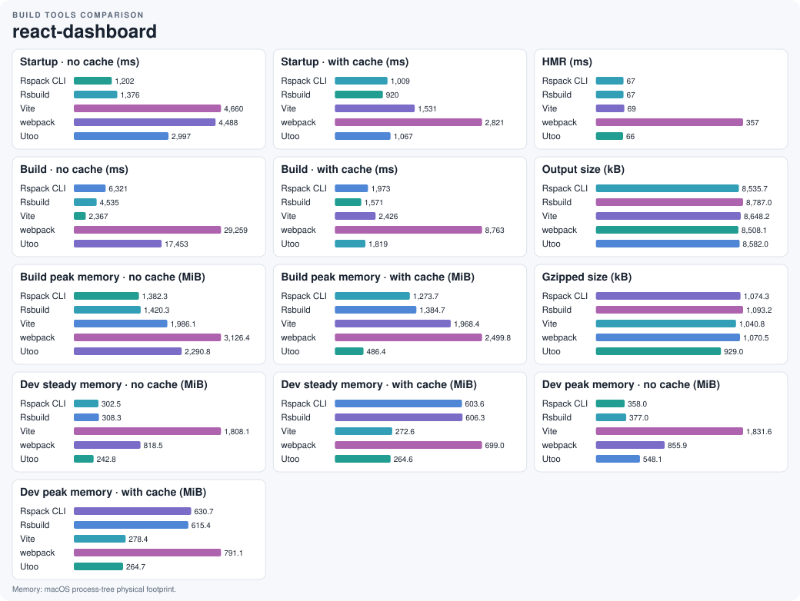
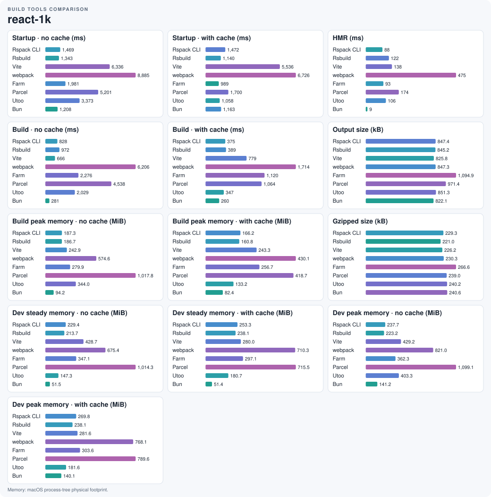
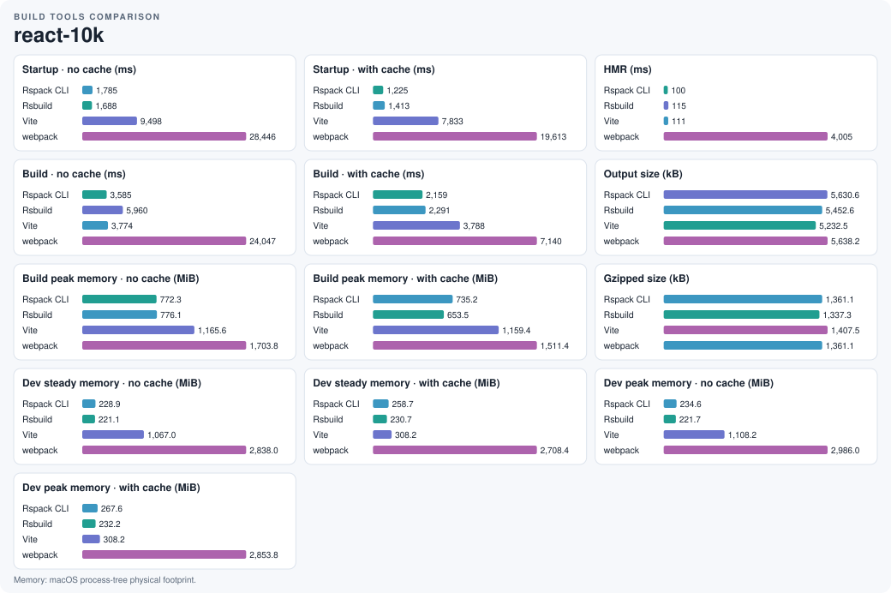
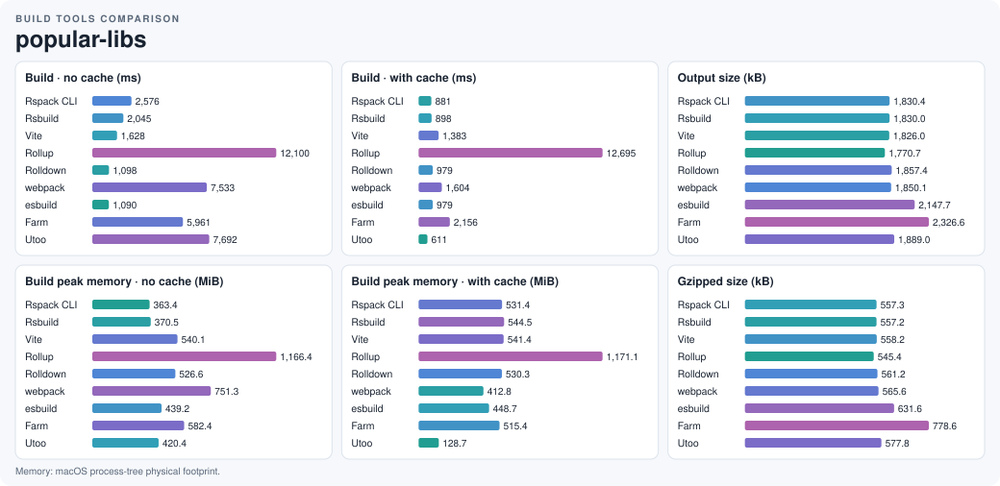

# Build Tools Comparison

Benchmark comparing JavaScript bundlers and build tools ([Rspack](https://github.com/web-infra-dev/rspack), [Rsbuild](https://github.com/web-infra-dev/rsbuild), [webpack](https://github.com/webpack/webpack), [Vite](https://github.com/vitejs/vite), [Rolldown](https://github.com/rolldown/rolldown), [esbuild](https://github.com/evanw/esbuild), [Rollup](https://github.com/rollup/rollup), [Parcel](https://github.com/parcel-bundler/parcel), [Farm](https://github.com/farm-fe/farm), [Utoo](https://github.com/utooland/utoo) and [Bun](https://bun.com)) for dev server startup time, build performance and bundle size for applications with different module sizes.

## Results

See [metrics](#metrics) and [notes](#notes) for details.

> Data from [GitHub Actions](https://github.com/rstackjs/build-tools-performance/actions/runs/43649700631) (2026-11-15 UTC+8, benchmark commit `0dffa8f5`). Memory uses macOS process-tree physical footprint.

---

### react-dashboard

A synthetic enterprise operations dashboard with 40 lazy routes and 29 common libraries, including React, Tailwind CSS, TanStack Router, Zod, and Recharts.

See [case details](cases/react-dashboard/README.md).

```bash
CASE=react-dashboard pnpm benchmark
```

<!-- benchmark-chart:start -->
<picture>
  <source media="(prefers-color-scheme: dark)" srcset="assets/charts/react-dashboard-dark.svg">
  
</picture>
<!-- benchmark-chart:end -->

<details>
<summary>Full benchmark data</summary>

Development metrics:

| Name             | Startup (no cache) | Startup (with cache) | HMR     |
| ---------------- | ------------------ | -------------------- | ------- |
| Rspack CLI 2.3.2 | 3716ms🥈           | 2381ms🥈             | 699ms   |
| Rsbuild 2.3.2    | 3459ms🥇           | 2064ms🥇             | 566ms🥉 |
| Vite 8.3.8       | 5342ms🥉           | 3329ms               | 409ms🥈 |
| webpack 5.112.2  | 10050ms            | 7076ms               | 873ms   |
| Utoo 1.6.3       | 7750ms             | 2452ms🥉             | 396ms🥇 |

Build metrics:

| Name             | Build (no cache) | Build (with cache) | Output size | Gzipped size |
| ---------------- | ---------------- | ------------------ | ----------- | ------------ |
| Rspack CLI 2.3.2 | 4335ms🥉         | 1994ms🥉           | 4153.7kB🥉  | 639.1kB🥉    |
| Rsbuild 2.3.2    | 3347ms🥈         | 1737ms🥈           | 4151.5kB🥈  | 637.1kB🥈    |
| Vite 8.3.8       | 2337ms🥇         | 2478ms             | 4168.1kB    | 649.5kB      |
| webpack 5.112.2  | 24776ms          | 7330ms             | 4158.0kB    | 641.4kB      |
| Utoo 1.6.3       | 22580ms          | 1497ms🥇           | 4132.2kB🥇  | 618.2kB🥇    |

Dev memory (MiB):

| Name             | Steady (no cache) | Steady (with cache) | Peak (no cache) | Peak (with cache) |
| ---------------- | ----------------- | ------------------- | --------------- | ----------------- |
| Rspack CLI 2.3.2 | 587.7🥈           | 870.3               | 598.1🥇         | 887.8             |
| Rsbuild 2.3.2    | 605.8🥉           | 910.2               | 646.9🥈         | 927.0             |
| Vite 8.3.8       | 1050.9            | 333.3🥈             | 1090.7          | 333.3🥇           |
| webpack 5.112.2  | 903.6             | 801.6🥉             | 912.2           | 854.2🥉           |
| Utoo 1.6.3       | 363.3🥇           | 280.6🥇             | 690.8🥉         | 438.1🥈           |

Build memory (MiB):

| Name             | Peak (no cache) | Peak (with cache) |
| ---------------- | --------------- | ----------------- |
| Rspack CLI 2.3.2 | 749.1🥇         | 793.6🥈           |
| Rsbuild 2.3.2    | 761.7🥈         | 823.9🥉           |
| Vite 8.3.8       | 1059.6🥉        | 1056.7            |
| webpack 5.112.2  | 1627.8          | 1292.4            |
| Utoo 1.6.3       | 1154.4          | 280.7🥇           |

</details>

---

### react-1k

A React app with 1,000 components and 1,500 modules from node_modules, using dynamic imports to simulate SPA.

```bash
CASE=react-1k pnpm benchmark
```

<!-- benchmark-chart:start -->
<picture>
  <source media="(prefers-color-scheme: dark)" srcset="assets/charts/react-1k-dark.svg">
  
</picture>
<!-- benchmark-chart:end -->

<details>
<summary>Full benchmark data</summary>

Development metrics:

| Name             | Startup (no cache) | Startup (with cache) | HMR     |
| ---------------- | ------------------ | -------------------- | ------- |
| Rspack CLI 2.3.2 | 2276ms🥉           | 1758ms               | 109ms   |
| Rsbuild 2.3.2    | 2072ms🥈           | 1438ms🥈             | 126ms   |
| Vite 8.3.8       | 8414ms             | 7634ms               | 136ms   |
| webpack 5.112.2  | 9648ms             | 8275ms               | 560ms   |
| Farm 1.7.11      | 2658ms             | 1632ms🥉             | 68ms🥈  |
| Parcel 2.16.4    | 6761ms             | 2212ms               | 186ms   |
| Utoo 1.6.3       | 11366ms            | 1762ms               | 100ms🥉 |
| Bun 1.4.4        | 1674ms🥇           | 1199ms🥇             | 8ms🥇   |

Build metrics:

| Name             | Build (no cache) | Build (with cache) | Output size | Gzipped size |
| ---------------- | ---------------- | ------------------ | ----------- | ------------ |
| Rspack CLI 2.3.2 | 1059ms           | 562ms🥈            | 847.4kB     | 229.3kB🥉    |
| Rsbuild 2.3.2    | 959ms🥈          | 578ms🥉            | 845.2kB🥉   | 221.0kB🥇    |
| Vite 8.3.8       | 998ms🥉          | 847ms              | 825.8kB🥈   | 226.2kB🥈    |
| webpack 5.112.2  | 8477ms           | 2178ms             | 847.3kB     | 230.3kB      |
| Farm 1.7.11      | 3367ms           | 1603ms             | 1094.9kB    | 266.6kB      |
| Parcel 2.16.4    | 5995ms           | 1516ms             | 971.4kB     | 239.0kB      |
| Utoo 1.6.3       | 7716ms           | 744ms              | 851.3kB     | 240.2kB      |
| Bun 1.4.4        | 356ms🥇          | 290ms🥇            | 822.1kB🥇   | 240.6kB      |

Dev memory (MiB):

| Name             | Steady (no cache) | Steady (with cache) | Peak (no cache) | Peak (with cache) |
| ---------------- | ----------------- | ------------------- | --------------- | ----------------- |
| Rspack CLI 2.3.2 | 240.0             | 259.7               | 282.8🥉         | 302.3             |
| Rsbuild 2.3.2    | 221.2🥉           | 239.0🥉             | 222.7🥈         | 239.0🥉           |
| Vite 8.3.8       | 428.7             | 281.1               | 429.9           | 282.2             |
| webpack 5.112.2  | 716.9             | 723.7               | 857.6           | 786.2             |
| Farm 1.7.11      | 349.0             | 302.8               | 368.1           | 304.3             |
| Parcel 2.16.4    | 1069.0            | 779.2               | 1097.8          | 900.5             |
| Utoo 1.6.3       | 149.7🥈           | 180.8🥈             | 399.3           | 181.0🥈           |
| Bun 1.4.4        | 51.1🥇            | 51.9🥇              | 134.0🥇         | 141.5🥇           |

Build memory (MiB):

| Name             | Peak (no cache) | Peak (with cache) |
| ---------------- | --------------- | ----------------- |
| Rspack CLI 2.3.2 | 185.6🥈         | 163.0             |
| Rsbuild 2.3.2    | 190.8🥉         | 158.5🥉           |
| Vite 8.3.8       | 244.5           | 245.9             |
| webpack 5.112.2  | 582.7           | 426.3             |
| Farm 1.7.11      | 285.3           | 258.2             |
| Parcel 2.16.4    | 1012.6          | 450.5             |
| Utoo 1.6.3       | 343.2           | 136.6🥈           |
| Bun 1.4.4        | 97.2🥇          | 100.1🥇           |

</details>

---

### react-5k

A React app with 5,000 components and 5,000 modules from node_modules, using dynamic imports to simulate SPA.

```bash
CASE=react-5k pnpm benchmark
```

<!-- benchmark-chart:start -->
<picture>
  <source media="(prefers-color-scheme: dark)" srcset="assets/charts/react-5k-dark.svg">
  
</picture>
<!-- benchmark-chart:end -->

<details>
<summary>Full benchmark data</summary>

Development metrics:

| Name             | Startup (no cache) | Startup (with cache) | HMR     |
| ---------------- | ------------------ | -------------------- | ------- |
| Rspack CLI 2.3.2 | 1611ms🥈           | 1895ms🥉             | 82ms🥇  |
| Rsbuild 2.3.2    | 1408ms🥇           | 1067ms🥈             | 106ms🥈 |
| Vite 8.3.8       | 5655ms             | 4613ms               | 127ms🥉 |
| webpack 5.112.2  | 14833ms            | 13862ms              | 1486ms  |
| Farm 1.7.11      | 2219ms🥉           | 876ms🥇              | 140ms   |
| Parcel 2.16.4    | 15405ms            | 2460ms               | 443ms   |

Build metrics:

| Name             | Build (no cache) | Build (with cache) | Output size | Gzipped size |
| ---------------- | ---------------- | ------------------ | ----------- | ------------ |
| Rspack CLI 2.3.2 | 1947ms🥈         | 1047ms🥇           | 2707.7kB🥉  | 682.4kB🥉    |
| Rsbuild 2.3.2    | 2259ms🥉         | 1144ms🥈           | 2637.8kB🥈  | 675.6kB🥇    |
| Vite 8.3.8       | 1471ms🥇         | 1442ms🥉           | 2541.9kB🥇  | 693.8kB      |
| webpack 5.112.2  | 16445ms          | 4748ms             | 2710.7kB    | 682.2kB🥈    |
| Farm 1.7.11      | 7097ms           | 2519ms             | 3459.4kB    | 803.2kB      |
| Parcel 2.16.4    | 16240ms          | 2831ms             | 3403.9kB    | 767.7kB      |

Dev memory (MiB):

| Name             | Steady (no cache) | Steady (with cache) | Peak (no cache) | Peak (with cache) |
| ---------------- | ----------------- | ------------------- | --------------- | ----------------- |
| Rspack CLI 2.3.2 | 190.5🥈           | 200.2🥈             | 207.9🥈         | 206.3🥈           |
| Rsbuild 2.3.2    | 176.4🥇           | 180.0🥇             | 178.9🥇         | 186.8🥇           |
| Vite 8.3.8       | 652.3             | 240.0🥉             | 667.7           | 240.0🥉           |
| webpack 5.112.2  | 1230.3            | 1799.0              | 1896.5          | 1909.5            |
| Farm 1.7.11      | 345.2🥉           | 323.1               | 350.9🥉         | 325.3             |
| Parcel 2.16.4    | 1390.0            | 1027.6              | 1590.7          | 1245.7            |

Build memory (MiB):

| Name             | Peak (no cache) | Peak (with cache) |
| ---------------- | --------------- | ----------------- |
| Rspack CLI 2.3.2 | 421.1🥇         | 422.1🥉           |
| Rsbuild 2.3.2    | 435.0🥉         | 369.5🥇           |
| Vite 8.3.8       | 628.1           | 625.0             |
| webpack 5.112.2  | 1134.6          | 929.7             |
| Farm 1.7.11      | 432.7🥈         | 378.8🥈           |
| Parcel 2.16.4    | 1786.2          | 576.7             |

</details>

---

### react-10k

A React app with 10,000 components and 10,000 modules from node_modules, using dynamic imports to simulate SPA.

```bash
CASE=react-10k pnpm benchmark
```

<!-- benchmark-chart:start -->
<picture>
  <source media="(prefers-color-scheme: dark)" srcset="assets/charts/react-10k-dark.svg">
  
</picture>
<!-- benchmark-chart:end -->

<details>
<summary>Full benchmark data</summary>

Development metrics:

| Name             | Startup (no cache) | Startup (with cache) | HMR     |
| ---------------- | ------------------ | -------------------- | ------- |
| Rspack CLI 2.3.2 | 881ms🥈            | 637ms🥈              | 61ms🥇  |
| Rsbuild 2.3.2    | 719ms🥇            | 582ms🥇              | 106ms🥈 |
| Vite 8.3.8       | 3759ms🥉           | 2965ms🥉             | 147ms🥉 |
| webpack 5.112.2  | 12656ms            | 7487ms               | 1520ms  |

Build metrics:

| Name             | Build (no cache) | Build (with cache) | Output size | Gzipped size |
| ---------------- | ---------------- | ------------------ | ----------- | ------------ |
| Rspack CLI 2.3.2 | 1732ms🥈         | 896ms🥈            | 5630.6kB🥉  | 1361.1kB🥈   |
| Rsbuild 2.3.2    | 1763ms🥉         | 861ms🥇            | 5452.6kB🥈  | 1337.3kB🥇   |
| Vite 8.3.8       | 1117ms🥇         | 1083ms🥉           | 5232.5kB🥇  | 1407.5kB     |
| webpack 5.112.2  | 14009ms          | 4041ms             | 5638.2kB    | 1361.1kB🥉   |

Dev memory (MiB):

| Name             | Steady (no cache) | Steady (with cache) | Peak (no cache) | Peak (with cache) |
| ---------------- | ----------------- | ------------------- | --------------- | ----------------- |
| Rspack CLI 2.3.2 | 231.7🥈           | 257.2🥈             | 238.5🥈         | 257.8🥈           |
| Rsbuild 2.3.2    | 214.7🥇           | 233.5🥇             | 218.2🥇         | 233.5🥇           |
| Vite 8.3.8       | 1106.1🥉          | 301.7🥉             | 1110.4🥉        | 301.8🥉           |
| webpack 5.112.2  | 2658.4            | 2401.6              | 2838.2          | 2531.0            |

Build memory (MiB):

| Name             | Peak (no cache) | Peak (with cache) |
| ---------------- | --------------- | ----------------- |
| Rspack CLI 2.3.2 | 772.5🥇         | 746.8🥈           |
| Rsbuild 2.3.2    | 782.6🥈         | 649.6🥇           |
| Vite 8.3.8       | 1204.9🥉        | 1201.4🥉          |
| webpack 5.112.2  | 1849.3          | 1543.6            |

</details>

---

### ui-components

A React app that imports UI components from several popular UI libraries.

Including [@mui/material](https://npmjs.com/package/@mui/material), [@radix-ui/themes](https://npmjs.com/package/@radix-ui/themes), [antd](https://npmjs.com/package/antd), [antd-mobile](https://npmjs.com/package/antd-mobile), [@chakra-ui/react](https://npmjs.com/package/@chakra-ui/react), [@fluentui/react](https://npmjs.com/package/@fluentui/react), [@headlessui/react](https://npmjs.com/package/@headlessui/react), [@mantine/core](https://npmjs.com/package/@mantine/core), [react-bootstrap](https://npmjs.com/package/react-bootstrap), [primereact](https://npmjs.com/package/primereact), [rsuite](https://npmjs.com/package/rsuite), [@arco-design/web-react](https://npmjs.com/package/@arco-design/web-react), [@coreui/react](https://npmjs.com/package/@coreui/react), [element-plus](https://npmjs.com/package/element-plus), [ant-design-vue](https://npmjs.com/package/ant-design-vue), [naive-ui](https://npmjs.com/package/naive-ui), [primevue](https://npmjs.com/package/primevue), [vant](https://npmjs.com/package/vant), and [vuetify](https://npmjs.com/package/vuetify).

```bash
CASE=ui-components pnpm benchmark
```

<!-- benchmark-chart:start -->
<picture>
  <source media="(prefers-color-scheme: dark)" srcset="assets/charts/ui-components-dark.svg">
  
</picture>
<!-- benchmark-chart:end -->

<details>
<summary>Full benchmark data</summary>

Build metrics:

| Name             | Build (no cache) | Build (with cache) | Output size | Gzipped size |
| ---------------- | ---------------- | ------------------ | ----------- | ------------ |
| Rspack CLI 2.3.2 | 3685ms🥉         | 898ms🥈            | 4961.5kB🥈  | 1442.7kB🥈   |
| Rsbuild 2.3.2    | 3730ms           | 1241ms             | 4961.3kB🥇  | 1442.1kB🥇   |
| Vite 8.3.8       | 2671ms🥇         | 2659ms             | 4963.0kB🥉  | 1448.9kB     |
| webpack 5.112.2  | 12363ms          | 5293ms             | 4974.9kB    | 1443.9kB🥉   |
| esbuild 0.28.2   | 3400ms🥈         | 2925ms             | 6178.5kB    | 1798.4kB     |
| Farm 1.7.11      | 13257ms          | 3102ms             | 8510.5kB    | 2907.9kB     |
| Parcel 2.16.4    | 20632ms          | 1198ms🥉           | 5357.8kB    | 1519.1kB     |
| Utoo 1.6.3       | 15682ms          | 734ms🥇            | 5006.5kB    | 1456.3kB     |

Build memory (MiB):

| Name             | Peak (no cache) | Peak (with cache) |
| ---------------- | --------------- | ----------------- |
| Rspack CLI 2.3.2 | 1063.7🥇        | 1246.1🥉          |
| Rsbuild 2.3.2    | 1164.7🥉        | 1281.1            |
| Vite 8.3.8       | 1791.7          | 1745.8            |
| webpack 5.112.2  | 1769.0          | 1452.9            |
| esbuild 0.28.2   | 1493.2          | 1478.6            |
| Farm 1.7.11      | 1700.2          | 1395.5            |
| Parcel 2.16.4    | 3396.0          | 929.0🥈           |
| Utoo 1.6.3       | 1084.0🥈        | 247.8🥇           |

</details>

---

### popular-libs

A browser app that imports a small number of live exports from 50 popular,
modern frontend libraries to compare tree-shaking quality across bundlers.

It keeps the original React/Vue/state/data set and adds 30 more mainstream
frontend packages with ESM-friendly entry points where practical, including
[axios](https://npmjs.com/package/axios),
[dayjs](https://npmjs.com/package/dayjs),
[clsx](https://npmjs.com/package/clsx),
[tailwind-merge](https://npmjs.com/package/tailwind-merge),
[class-variance-authority](https://npmjs.com/package/class-variance-authority),
[i18next](https://npmjs.com/package/i18next),
[react-i18next](https://npmjs.com/package/react-i18next),
[vue-i18n](https://npmjs.com/package/vue-i18n),
[immer](https://npmjs.com/package/immer),
[swr](https://npmjs.com/package/swr),
[framer-motion](https://npmjs.com/package/framer-motion),
[three](https://npmjs.com/package/three),
[lucide-react](https://npmjs.com/package/lucide-react),
[@headlessui/react](https://npmjs.com/package/@headlessui/react),
[@headlessui/vue](https://npmjs.com/package/@headlessui/vue),
[@heroicons/react](https://npmjs.com/package/@heroicons/react),
[@heroicons/vue](https://npmjs.com/package/@heroicons/vue),
[@radix-ui/react-slot](https://npmjs.com/package/@radix-ui/react-slot),
[query-string](https://npmjs.com/package/query-string),
[mitt](https://npmjs.com/package/mitt),
[fuse.js](https://npmjs.com/package/fuse.js),
[idb](https://npmjs.com/package/idb),
[dexie](https://npmjs.com/package/dexie),
[ky](https://npmjs.com/package/ky),
[lit](https://npmjs.com/package/lit),
[xstate](https://npmjs.com/package/xstate),
[preact](https://npmjs.com/package/preact),
[solid-js](https://npmjs.com/package/solid-js),
[swiper](https://npmjs.com/package/swiper), and
[remeda](https://npmjs.com/package/remeda).

```bash
CASE=popular-libs pnpm benchmark
```

<!-- benchmark-chart:start -->
<picture>
  <source media="(prefers-color-scheme: dark)" srcset="assets/charts/popular-libs-dark.svg">
  
</picture>
<!-- benchmark-chart:end -->

<details>
<summary>Full benchmark data</summary>

Build metrics:

| Name             | Build (no cache) | Build (with cache) | Output size | Gzipped size |
| ---------------- | ---------------- | ------------------ | ----------- | ------------ |
| Rspack CLI 2.3.2 | 2576ms           | 881ms🥈            | 1830.4kB    | 557.3kB🥉    |
| Rsbuild 2.3.2    | 2045ms           | 898ms🥉            | 1830.0kB🥉  | 557.2kB🥈    |
| Vite 8.3.8       | 1628ms🥉         | 1383ms             | 1826.0kB🥈  | 558.2kB      |
| Rollup 4.68.3    | 12100ms          | 12695ms            | 1770.7kB🥇  | 545.4kB🥇    |
| Rolldown 1.3.2   | 1098ms🥈         | 979ms              | 1857.4kB    | 561.2kB      |
| webpack 5.112.2  | 7533ms           | 1604ms             | 1850.1kB    | 565.6kB      |
| esbuild 0.28.2   | 1090ms🥇         | 979ms              | 2147.7kB    | 631.6kB      |
| Farm 1.7.11      | 5961ms           | 2156ms             | 2326.6kB    | 778.6kB      |
| Utoo 1.6.3       | 7692ms           | 611ms🥇            | 1889.0kB    | 577.8kB      |

Build memory (MiB):

| Name             | Peak (no cache) | Peak (with cache) |
| ---------------- | --------------- | ----------------- |
| Rspack CLI 2.3.2 | 363.4🥇         | 531.4             |
| Rsbuild 2.3.2    | 370.5🥈         | 544.5             |
| Vite 8.3.8       | 540.1           | 541.4             |
| Rollup 4.68.3    | 1166.4          | 1171.1            |
| Rolldown 1.3.2   | 526.6           | 530.3             |
| webpack 5.112.2  | 751.3           | 412.8🥈           |
| esbuild 0.28.2   | 439.2           | 448.7🥉           |
| Farm 1.7.11      | 582.4           | 515.4             |
| Utoo 1.6.3       | 420.4🥉         | 128.7🥇           |

</details>

---

## Metrics

| Name                     | Description                                                                            |
| ------------------------ | -------------------------------------------------------------------------------------- |
| **Startup (no cache)**   | Time from starting the dev server to page loaded                                       |
| **Startup (with cache)** | Time from starting the dev server to page loaded with cache                            |
| **HMR**                  | Time to HMR after changing a module                                                    |
| **Build (no cache)**     | Time taken to build the production bundles                                             |
| **Build (with cache)**   | Time taken to build the production bundles with cache                                  |
| **Memory steady**        | Dev server memory after 10 HMR updates and a fixed idle window, with and without cache |
| **Memory peak**          | Sampled peak memory during dev or a production build, with and without cache           |
| **Output size**          | Total size of the output bundle, minified with the configured minifier                 |
| **Gzipped size**         | Gzipped size of the output bundle, represents actual network transfer size             |

## Notes

- Build targets are `Chrome >= 93` or `es2022`.
- Minification is enabled in production for all tools.
- Source map is enabled in development and disabled in production for all tools.
- Benchmarks run on GitHub Actions with variable hardware, which may cause inconsistent results.

Tooling details:

- webpack is configured to use SWC instead of Babel / Terser.
- Vite uses Rolldown and Oxc.

## Run locally

To regenerate the charts from the current README tables without running benchmarks:

```bash
pnpm charts
```

Run the `benchmark.ts` script to get the results (requires Node.js >= 22):

```bash
# Run the benchmark for the react-5k case
pnpm benchmark

# Run the benchmark for the react-10k case
CASE=react-10k pnpm benchmark
```

If you want to start the project with the specified tool, try:

```bash
pnpm i # install dependencies

# Cd to the case directory
cd cases/react-5k
cd cases/react-10k
cd cases/popular-libs

# Dev server
pnpm start:rspack # Start Rspack
pnpm start:rsbuild # Start Rsbuild
pnpm start:webpack # Start webpack
pnpm start:vite # Start Vite
pnpm start:farm # Start Farm

# Build
pnpm build:rspack # Build Rspack
pnpm build:rsbuild # Build Rsbuild
pnpm build:webpack # Build webpack
pnpm build:vite # Build Vite
pnpm build:farm # Build Farm
```

### Options

Use `CASE` to switch the benchmark case:

```bash
CASE=react-1k pnpm benchmark
CASE=react-5k pnpm benchmark
CASE=react-10k pnpm benchmark
CASE=popular-libs pnpm benchmark
```

Use `TOOLS` to specify the build tools or bundlers:

```bash
# Run with all tools
TOOLS=all pnpm benchmark

# Run Rspack and Rsbuild
TOOLS=rspack,rsbuild pnpm benchmark
```

Use `RUN_TIMES` to specify the number of runs (defaults to `3`):

```bash
RUN_TIMES=3 pnpm benchmark
```

Use `WARMUP_TIMES` to specify the number of warmup runs (defaults to `2`):

```bash
WARMUP_TIMES=2 pnpm benchmark
```

Use `FARM=true` to run Farm:

```bash
FARM=true pnpm benchmark
```

## Credits

Forked from [farm-fe/performance-compare](https://github.com/farm-fe/performance-compare), thanks to the Farm team!

## Memory methodology

- Sample the command process tree every ~50 ms, excluding the browser and benchmark driver. Use macOS **physical footprint** (requires Xcode Command Line Tools) or Linux **RSS**; these metrics are not comparable across platforms.
- Measure timing and memory in separate passes, each with cold/warm caches and natural GC.
- **Dev steady:** load `/`, perform 10 root/leaf HMR updates, then idle for 5 seconds and take the median over 2 seconds. **Peak:** the largest sampled process-tree total during dev startup through this window, or during a build.
- Report **MiB** as the median across runs. Raw samples and summaries are saved in `results/` and uploaded as CI artifacts.
